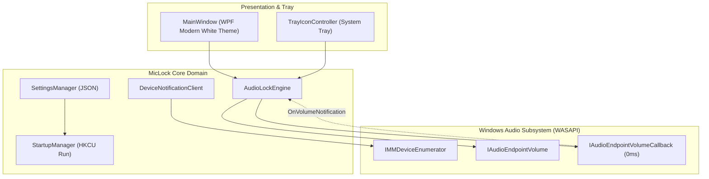

# 🛡️ MicLock: Windows Microphone Volume Lock

[](LICENSE)
[](https://microsoft.com/windows)
[](https://dotnet.microsoft.com)
[]()

> **A standalone, event-driven Windows system tray desktop utility that permanently prevents apps (Discord, Zoom, Steam, WebRTC, CS:GO) from silently lowering your microphone volume.**

---

## ⚡ Why MicLock?

Many popular communication and gaming applications (Discord's auto-gain, Zoom, Skype, Steam voice, WebRTC in Chrome) silently reduce your Windows microphone recording volume when they detect peaks or background noise.

### Comparison: MicLock vs. PowerShell Scripts

| Feature | PowerShell / Task Scheduler Scripts | 🛡️ **MicLock Standalone** |
| :--- | :--- | :--- |
| **Response Latency** | 🐌 **2 to 10 seconds** (polling timer) | ⚡ **< 1 millisecond** (WASAPI Event-driven) |
| **CPU Overhead** | ⚠️ Noticeable `powershell.exe` CPU spikes | 🟢 **0.00% CPU** idle (event callback) |
| **System Tray Icon** | ❌ None (invisible or awkward window) | ✅ **Live Tray Icon + Tooltip** with volume % |
| **User Interface** | ❌ None (terminal or raw config files) | ✅ **Modern White Dashboard** (Clean Fluent UI) |
| **Elevation Required**| ⚠️ Often requires Admin / Task Scheduler | 🛡️ **Zero Elevation** (per-user autostart) |
| **Hotplug Handling** | ❌ Crashes when USB mic is unplugged | ✅ **Auto-reconnects** (`IMMNotificationClient`) |
| **Distribution** | ❌ Fragmented `.ps1` + `.vbs` + XML tasks | ✅ **Single 580 KB `.exe` or 2 MB Installer** |

---

## 🚀 Key Capabilities

- **Zero-Latency WASAPI Volume Enforcement:** Implements Windows native `IAudioEndpointVolumeCallback`. The microsecond Discord or Zoom alters the endpoint scalar, MicLock snaps it back to your target level with loop-prevention guards.
- **Tray Icon Mouse Wheel Volume Control:** Scroll your mouse wheel directly over the system tray icon to raise or lower microphone volume in 5% increments, complete with a live tooltip and SoundSwitch-style OSD banner.
- **SoundSwitch-Style OSD Floating Banner:** A sleek, non-intrusive floating dark banner (inspired by SoundSwitch) that displays when muting, unmuting, or adjusting volume, complete with a cyan microphone icon, mute indicator, and active device name.
- **PowerToys & Keyboard Remap Ready:**
  - **Global Hotkey:** `Ctrl + Shift + Alt + M` (matching SoundSwitch standard).
  - **CLI IPC Trigger:** `MicLock.exe --toggle-mute` communicates with the background instance in <15ms. Map any keyboard key (e.g. dedicated Mic button, F20) via PowerToys Keyboard Manager directly.
- **Two Applications in One Suite:**
  - 🛡️ **MicLock:** Complete desktop app with volume lock enforcement, mute toggle, device selector, tray volume scroll, and settings.
  - 🎙️ **MicMute:** Ultra-simple, lightweight dedicated mute toggle tool with a 1-click button, tray middle-click toggle, and OSD banner.
- **Hardware Device Pinning & USB Hotplugging:** Lock your specific USB microphone (Samson Go Mic, Blue Yeti, Elgato Wave) or follow `[Default Device]`. Re-attaches instantly if USB is unplugged and plugged back in.
- **Zero-Elevation Autostart:** Per-user installation in `%LOCALAPPDATA%\Programs\MicLock` with autostart in `HKCU\Software\Microsoft\Windows\CurrentVersion\Run`. Zero UAC elevation required.

---

## 📦 Download & Installation

### Option 1: Installer (Recommended)
Download **`MicLock-Setup-v1.0.0.exe`** from [Releases](../../releases).
- Runs without administrator privileges.
- Installs both **MicLock** and **MicMute** to `%LOCALAPPDATA%\Programs\MicLock`.
- Offers desktop shortcuts and automatic Windows startup.
- Includes a clean uninstaller in Windows Settings / Apps.

### Option 2: Portable Single-File Executables
- **`MicLock.exe`**: Unified desktop app with volume lock, mute toggle, and tray scroll.
- **`MicMute.exe`**: Lightweight dedicated mute toggle app with SoundSwitch OSD banner.
- Self-contained, zero prerequisite installs needed.

---

## 🛠️ Architecture Overview



---

## 💻 Building from Source

### Prerequisites
- Windows 10 or 11 (64-bit)
- [.NET 8.0 SDK](https://dotnet.microsoft.com/download/dotnet/8.0)
- [Inno Setup 6](https://jrsoftware.org/isinfo.php) (optional, for compiling the installer)

### Build Commands

```powershell
# 1. Clone the repository
git clone https://github.com/developer/mic-lock.git
cd mic-lock

# 2. Run automated test suite (10 unit & WASAPI integration tests)
dotnet test

# 3. Publish single-file executable
dotnet publish src/MicLock.App/MicLock.App.csproj -c Release -r win-x64 --self-contained false -p:PublishSingleFile=true -o dist/win-x64

# 4. Build Inno Setup Installer
iscc installer/MicLock.iss
```

---

## 📄 License

This project is licensed under the [MIT License](LICENSE).
Feel free to use, modify, and distribute for personal or commercial purposes.
