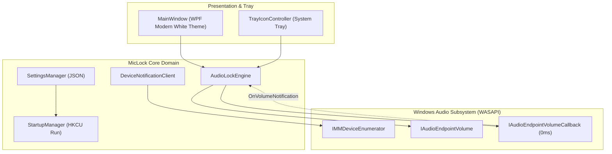

# 🛡️ MicLock: Windows Microphone Volume Lock

[](LICENSE)
[](https://microsoft.com/windows)
[](https://dotnet.microsoft.com)
[]()

> **A standalone, event-driven Windows system tray desktop utility that permanently prevents apps (Discord, Zoom, Steam, WebRTC, CS:GO) from silently lowering your microphone volume.**

---

## ⚡ Why MicLock?

Many popular communication and gaming applications (Discord's auto-gain, Zoom, Skype, Steam voice, WebRTC in Chrome) silently reduce your Windows microphone recording volume when they detect peaks or background noise.

### Comparison: MicLock vs. PowerShell Scripts

| Feature | PowerShell / Task Scheduler Scripts | 🛡️ **MicLock Standalone** |
| :--- | :--- | :--- |
| **Response Latency** | 🐌 **2 to 10 seconds** (polling timer) | ⚡ **< 1 millisecond** (WASAPI Event-driven) |
| **CPU Overhead** | ⚠️ Noticeable `powershell.exe` CPU spikes | 🟢 **0.00% CPU** idle (event callback) |
| **System Tray Icon** | ❌ None (invisible or awkward window) | ✅ **Live Tray Icon + Tooltip** with volume % |
| **User Interface** | ❌ None (terminal or raw config files) | ✅ **Modern White Dashboard** (Clean Fluent UI) |
| **Elevation Required**| ⚠️ Often requires Admin / Task Scheduler | 🛡️ **Zero Elevation** (per-user autostart) |
| **Hotplug Handling** | ❌ Crashes when USB mic is unplugged | ✅ **Auto-reconnects** (`IMMNotificationClient`) |
| **Distribution** | ❌ Fragmented `.ps1` + `.vbs` + XML tasks | ✅ **Single 580 KB `.exe` or 2 MB Installer** |

---

## 🚀 Key Capabilities

- **Zero-Latency WASAPI Enforcement:** Implements Windows native `IAudioEndpointVolumeCallback`. The microsecond Discord or Zoom alters the endpoint scalar, MicLock's callback executes and snaps it back to your target level with loop-prevention guards.
- **Dynamic System Tray Presence:**
  - Status indicator icon (Green Shield when locked, muted/warning when unlocked).
  - Tray tooltip shows current lock percentage and active microphone name.
  - Quick right-click context menu: Toggle lock, pick volume presets (`50%`, `75%`, `80%`, `90%`, `100%`), manage autostart, or open dashboard.
  - Minimizes silently to notification area on window close.
- **Hardware Device Pinning & Dynamic Fallback:** Lock your specific USB microphone (e.g. Samson Go Mic, Blue Yeti, Elgato Wave) or leave it on `[Default Device]` to follow Windows communication routing.
- **Resilient USB Hotplugging:** Monitors audio device topology via `IMMNotificationClient`. If you unplug your USB microphone and plug it back in, MicLock detects the arrival and re-attaches immediately.
- **Zero-Elevation Autostart:** Manages `HKCU\Software\Microsoft\Windows\CurrentVersion\Run` with the `--minimized` flag. Never triggers UAC prompts or console tabs on Windows boot.

---

## 📦 Download & Installation

### Option 1: Installer (Recommended)
Download **`MicLock-Setup-v1.0.0.exe`** from [Releases](../../releases).
- Runs without administrator privileges.
- Installs to `%LOCALAPPDATA%\Programs\MicLock`.
- Offers desktop shortcut and automatic Windows startup.
- Includes a clean uninstaller in Windows Settings / Apps.

### Option 2: Portable Single-File Executable
Download **`MicLock.exe`** (~580 KB) from [Releases](../../releases).
- Place it anywhere and run.
- Zero dependencies required on modern Windows 11 (uses built-in .NET 8 desktop runtime).

---

## 🛠️ Architecture Overview



---

## 💻 Building from Source

### Prerequisites
- Windows 10 or 11 (64-bit)
- [.NET 8.0 SDK](https://dotnet.microsoft.com/download/dotnet/8.0)
- [Inno Setup 6](https://jrsoftware.org/isinfo.php) (optional, for compiling the installer)

### Build Commands

```powershell
# 1. Clone the repository
git clone https://github.com/developer/mic-lock.git
cd mic-lock

# 2. Run automated test suite (10 unit & WASAPI integration tests)
dotnet test

# 3. Publish single-file executable
dotnet publish src/MicLock.App/MicLock.App.csproj -c Release -r win-x64 --self-contained false -p:PublishSingleFile=true -o dist/win-x64

# 4. Build Inno Setup Installer
iscc installer/MicLock.iss
```

---

## 📄 License

This project is licensed under the [MIT License](LICENSE).
Feel free to use, modify, and distribute for personal or commercial purposes.
